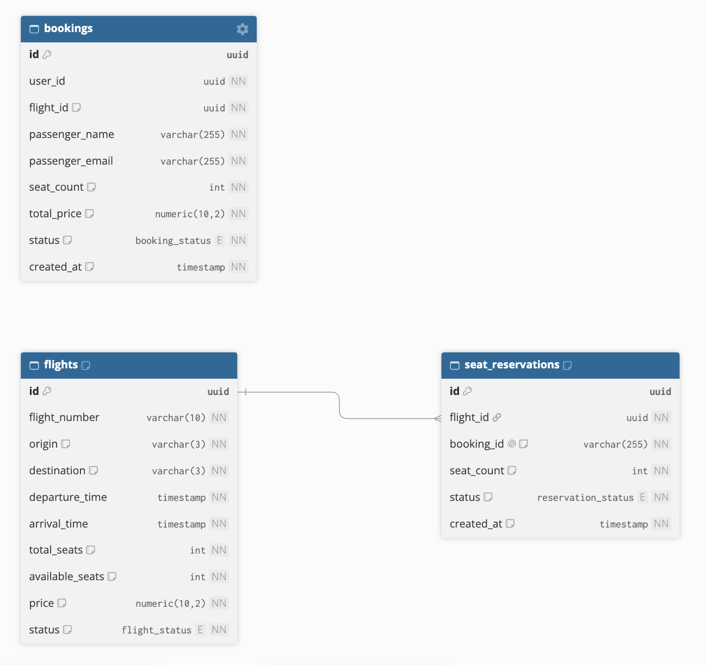

## ДЗ-3

Архитектура состоит из двух микросервисов, которые общаются по gRPC, с кэшированием в Redis и отказоустойчивостью.

- **Booking Service** (REST, порт 8000) — внешний API для клиентов, управляет бронированиями. Своя БД PostgreSQL.
- **Flight Service** (gRPC, порт 50051) — внутренний сервис, управляет рейсами и местами. Своя БД PostgreSQL + Redis.

## Что реализовано 

- **1. gRPC-контракт:** `proto/flight.proto`. Кодогенерация через `grpc_tools.protoc` (при сборке Docker-образа). Используются `Timestamp`, `enum` и стандартные коды ошибок (`NOT_FOUND`, `RESOURCE_EXHAUSTED`, `UNAUTHENTICATED`).
- **2. ER-диаграмма:** Схема данных спроектирована в 3NF. Таблицы `flights` и `seat_reservations` в Flight Service (связь 1-ко-многим), таблица `bookings` в Booking Service. Базы изолированы, связи на уровне Foreign Key между ними нет.
- **3. PostgreSQL + миграции:** Два независимых Postgres в `docker-compose.yml`. Миграции Alembic накатываются автоматически при старте контейнеров.
- **4. Межсервисное взаимодействие:** При создании брони Booking вызывает `GetFlight` (получить цену), затем `ReserveSeats`. Если резервирование упало — бронь в БД не создается.
- **5. Транзакционность:** В Flight Service резервирование мест происходит в одной транзакции с `SELECT FOR UPDATE` (защита от race condition). В Booking Service при ошибке записи в БД срабатывает компенсация (отправка `ReleaseReservation` в Flight).
- **6. Аутентификация:** API Key передается в gRPC metadata. Interceptor на стороне Flight Service проверяет его для всех методов и отдает `UNAUTHENTICATED`, если ключ неверный.
- **7. Кэширование:** Реализована стратегия Cache-Aside. TTL: 10 минут на рейс, 5 минут на поиск. Кэш инвалидируется при мутациях (резервирование/отмена). Логи содержат `CACHE HIT` / `CACHE MISS`.
- **8. Retry:** 3 попытки с экспоненциальной задержкой (0.1s, 0.2s, 0.4s). Ретраятся только `UNAVAILABLE` и `DEADLINE_EXCEEDED`. Идемпотентность `ReserveSeats` обеспечена через уникальный `booking_id`.
- **9. Redis Sentinel:** Мастер + реплика + 3 сентинела для кворума. Клиент в коде использует `redis.sentinel.Sentinel`.
- **10. Circuit Breaker:** Реализован вручную в `flight_client.py`. Три состояния (CLOSED, OPEN, HALF_OPEN), порог 5 ошибок, таймаут 30 секунд. Переходы логируются.

## Запуск

```bash
docker-compose up --build
```

Все поднимается одной командой. Миграции и seed-данные (3 тестовых рейса) применяются автоматически при старте. Сентинелы стартуют с задержкой в 10 секунд, чтобы мастер-нода и DNS успели подняться, поэтому ждать 30 секунд до первых запросов.

**Адреса:**
- REST API (Swagger): http://localhost:8000/docs
- gRPC: localhost:50051

## ER-Диаграмма


